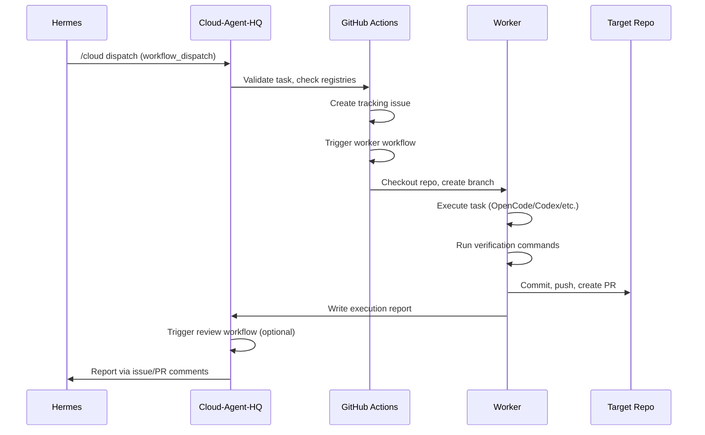

# Cloud Agent HQ

**Central infrastructure and orchestration repository for cloud-based multi-agent development workforce.**

[](https://github.com/Chimthuwu/Cloud-Agent-HQ/actions)
[](LICENSE)

---

## Overview

Cloud Agent HQ enables **Hermes** (local control center) to dispatch coding tasks to **cloud-based GitHub Actions runners**. Workers execute in isolated, ephemeral environments and return results via pull requests.

### Key Features

- **$0/month** for public repositories (GitHub Actions free tier)
- **Interchangeable workers:** OpenCode, Codex CLI, Gemini CLI, Claude Code
- **GitHub-native:** No persistent servers, all state in repos
- **Independent review:** Implementers ≠ reviewers
- **Hermes integration:** Native slash commands (`/cloud dispatch`, `/cloud batch`, etc.)
- **Repository registry:** Secure, auditable repository access control
- **Concurrency control:** Bounded parallelism with queue management

---

## Architecture

```
┌─────────────────┐     ┌──────────────────┐     ┌─────────────────────┐
│   Hermes CLI    │────▶│  Cloud-Agent-HQ  │────▶│  GitHub Actions     │
│  (Control       │     │  (Orchestration  │     │  (Compute Layer)    │
│   Centre)       │     │   Repository)    │     │                     │
└─────────────────┘     └──────────────────┘     └─────────────────────┘
                              │                          │
                              ▼                          ▼
                       ┌──────────────────┐     ┌─────────────────────┐
                       │  Registry &      │     │  Worker Adapters    │
                       │  Config (YAML)   │     │  (OpenCode, Codex,  │
                       └──────────────────┘     │   Gemini, Claude)   │
                                                └─────────────────────┘
```

---

## Quick Start

### 1. Prerequisites
- GitHub account with Actions enabled
- `gh` CLI authenticated (`gh auth login`)
- Python 3.11+ with `pyyaml`, `jsonschema`

### 2. Install Hermes Skill
```bash
# From Cloud-Agent-HQ repo root
cp -r cloud-agent-hq ~/.hermes/skills/
pip install pyyaml jsonschema
```

### 3. Configure Secrets (in Cloud-Agent-HQ repo)
| Secret | Required For |
|--------|--------------|
| `OPENCODE_GO_API_KEY` | OpenCode worker |
| `CLOUD_AGENT_HQ_PAT` | All workers (target repo access) |
| `OPENAI_API_KEY` | Codex (when ready) |
| `GOOGLE_API_KEY` | Gemini (when ready) |
| `ANTHROPIC_API_KEY` | Claude Code (when ready) |

### 4. Register a Repository
```bash
# Public repo (auto-dispatch enabled)
/register-repo Chimthuwu/MyProject --public

# Private repo (manual dispatch only)
/register-repo Chimthuwu/PrivateProject --private
```

### 5. Dispatch a Task
```bash
# Via Hermes slash command
/cloud dispatch Chimthuwu/MyProject "Fix the login bug" --worker opencode

# Via Python script
python scripts/dispatch-task.py dispatch Chimthuwu/MyProject "Fix the login bug"
```

---

## Worker Status

| Worker | Status | CLI | Auth | Notes |
|--------|--------|-----|------|-------|
| **OpenCode** | ✅ **Ready** | `opencode` | API Key | Primary verified worker |
| **Codex CLI** | ⚠️ Placeholder | `codex` | Device Code | Needs OAuth automation |
| **Gemini CLI** | ⚠️ Placeholder | `gemini` | API Key | Needs CLI install + verify |
| **Claude Code** | ⚠️ Placeholder | `claude` | OAuth | Needs OAuth automation |

---

## Documentation

| Document | Description |
|----------|-------------|
| [Architecture](docs/ARCHITECTURE.md) | System architecture & data flow |
| [Task Contract](docs/TASK_CONTRACT.md) | Task payload specification |
| [Worker Adapters](docs/WORKER_ADAPTERS.md) | Adapter implementation guide |
| [Repository Registry](docs/REPOSITORY_REGISTRY.md) | Registry format & policy |
| [Review Policy](docs/REVIEW_POLICY.md) | Independent review process |
| [Security](docs/SECURITY.md) | Security boundaries & threat model |
| [Hermes Integration](docs/HERMES_INTEGRATION.md) | Slash commands & programmatic API |

---

## Repository Structure

```
Cloud-Agent-HQ/
├── .github/workflows/       # GitHub Actions workflows
│   ├── dispatch-task.yml    # Task validation & dispatch
│   ├── worker-opencode.yml  # OpenCode execution
│   ├── worker-codex.yml     # Codex execution (placeholder)
│   ├── worker-gemini.yml    # Gemini execution (placeholder)
│   ├── worker-claude.yml    # Claude execution (placeholder)
│   └── review-pr.yml        # Independent review
├── dispatch/                # Task dispatch utilities
├── registry/                # Repository & worker registries
│   ├── repos.yaml           # Registered repositories
│   └── workers.yaml         # Worker profiles
├── workers/                 # Worker adapters
│   ├── opencode/            # ✅ Implemented
│   ├── codex/               # ⚠️ Placeholder
│   ├── gemini/              # ⚠️ Placeholder
│   └── claude/              # ⚠️ Placeholder
├── schemas/                 # JSON Schemas
│   ├── task-contract.json
│   ├── execution-report.json
│   └── review-report.json
├── scripts/                 # Hermes integration scripts
│   └── dispatch-task.py     # Main dispatch CLI
├── docs/                    # Documentation
└── tests/                   # Test infrastructure
    ├── mock-worker.sh       # Mock worker for CI tests
    ├── test-dispatch.sh     # Integration test
    └── test-concurrency.sh  # Concurrency load test
```

---

## Development Flow



---

## Cost

| Tier | Public Repos | Private Repos |
|------|--------------|---------------|
| **GitHub Free** | Unlimited minutes | 2,000 min/month |
| **GitHub Pro** | Unlimited | 3,000 min/month |
| **GitHub Team** | Unlimited | 10,000 min/month |

**AI Inference:** Uses existing free-tier providers (OpenRouter :free, NVIDIA NIM, etc.)

---

## Security

- No credentials in repository
- GitHub secrets for all API keys
- Least-privilege `GITHUB_TOKEN` permissions
- Fresh runner per task (complete isolation)
- Independent review required before merge
- See [Security Documentation](docs/SECURITY.md)

---

## Contributing

1. Fork the repository
2. Create a feature branch
3. Make changes with tests
4. Submit PR for review

---

## License

MIT License - see [LICENSE](LICENSE)

---

## Links

- **Repository:** https://github.com/Chimthuwu/Cloud-Agent-HQ
- **Actions:** https://github.com/Chimthuwu/Cloud-Agent-HQ/actions
- **Issues:** https://github.com/Chimthuwu/Cloud-Agent-HQ/issues
- **Hermes Agent:** https://hermes-agent.nousresearch.com